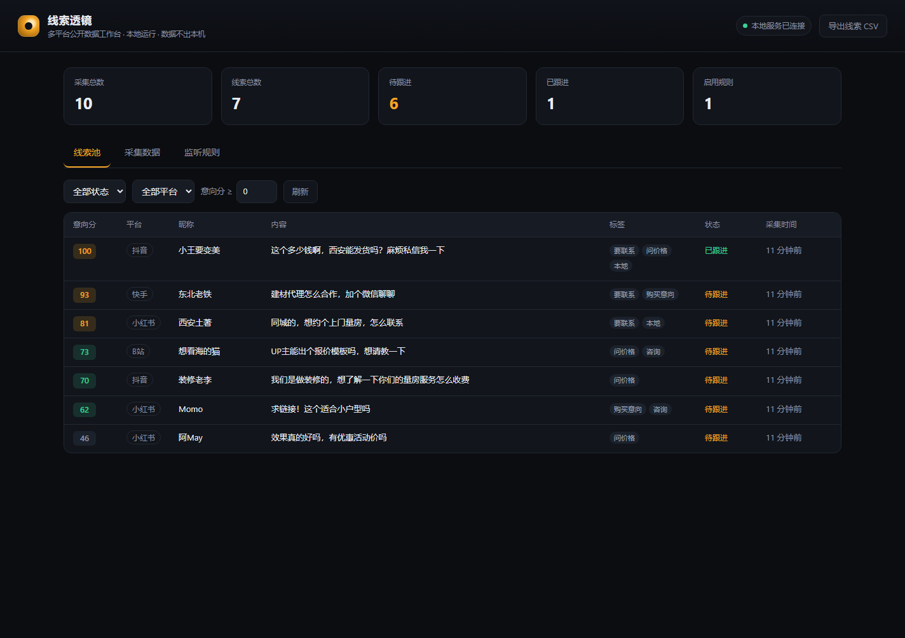

# 线索透镜 LeadLens

[](https://github.com/lynn/leadlens/actions/workflows/ci.yml)

开源的多平台社媒公开数据工作台。装一个浏览器扩展，把你在 **抖音 / 快手 / 小红书 / B站** 页面上能看到的公开评论，自动汇总到本机的工作台，并按意向自动打分、筛选、导出。

- **免费**：MIT 协议，无卡密、无授权服务器、无试用期
- **本地**：服务只监听 `127.0.0.1`，数据存在你自己电脑的 SQLite 里，不上传任何服务器
- **可改**：零运行时依赖，纯 Node + 原生前端，改词库/选择器不用重新打包
- **克制**：只读当前页面上公开可见的内容，不自动滚动、不点赞、不私信、不碰平台接口



---

## 为什么有这个项目

市面上这类「获客系统」大多是加壳的 Windows 成品：`.exe` 里塞了卡密校验，连着一台随时可能关停的授权服务器，杀软报毒、系统重装就失效，功能想改也改不了。

LeadLens 把这些能力重写成一份看得见、改得动、跑得起来的源码。它不包含原成品的任何二进制或代码，是独立实现。

---

## 架构

```
浏览器（已登录，你平时的账号）
┌─────────────────────────────────────────┐
│  抖音 / 快手 / 小红书 / B站 页面          │
│        │                                │
│        ▼                                │
│  content script  只读 DOM，每 2.5s 扫一次 │
│        │  批量 30 条                      │
│        ▼                                │
│  background（服务工作线程）               │
│        │  服务没开就先排队，起来自动补发    │
└────────┼────────────────────────────────┘
         │ HTTP POST 127.0.0.1:8787
         ▼
┌─────────────────────────────────────────┐
│  本地服务（Node，零依赖）                  │
│  ├─ 指纹去重（平台+作者+正文）             │
│  ├─ 意向打分（词库 + 关键词 + 互动 + 新鲜度）│
│  ├─ SQLite 落库（node:sqlite）            │
│  ├─ 线索池 / 规则 / CSV 导出               │
│  └─ 静态托管工作台页面                     │
└─────────────────────────────────────────┘
```

数据流是单向的：页面 → 本机。服务端从不主动访问任何平台。

---

## 快速开始

需要 Node.js **22.5+**（用到内置 `node:sqlite`）。

```bash
npm start
# 打开 http://127.0.0.1:8787
```

想看界面上有什么，先灌一批演示数据：

```bash
node scripts/seed-demo.mjs
```

### 装扩展

1. Chrome / Edge 打开 `chrome://extensions`
2. 右上角打开「开发者模式」
3. 「加载已解压的扩展程序」→ 选本仓库的 `extension/` 目录
4. 打开抖音/快手/小红书/B站的任意视频或笔记页，点评论区，扩展图标上会出现采集计数
5. 点扩展图标 → 「打开工作台」看线索池

> 扩展用你浏览器里现有的登录状态读取「你已经能看到的」评论区，不需要账号密码，也不解析登录凭证。

---

## 意向分是怎么算的

`server/leads.js` 里的词库决定一切，命中即加分，同类词只计一次（避免堆词刷分）：

| 分组 | 权重 | 例子 |
| --- | --- | --- |
| 要联系方式 | +40 | 私信、加我、怎么联系、微信 |
| 购买意愿 | +35 | 怎么买、求链接、下单、想买 |
| 问价格 | +30 | 多少钱、价格、报价、优惠 |
| 咨询 | +15 | 怎么用、有效果吗、靠谱吗 |
| 本地 | +10 | 同城、上门、城市名 |
| 噪音 | -45 | 互粉、互赞、刷单、进群、广告位 |

再叠加关键词命中（每条 +12，封顶 +36）、点赞量（最多 +12）、新鲜度（24 小时内 +8）。最终裁剪到 0–100。

默认分数线 45，可用「监听规则」按平台调整。改判断标准直接改词库，重启服务即可，不用动前端。

---

## 页面改版了怎么办

平台一改版，选择器就会失效，这是所有同类工具的通病。LeadLens 的处理方式是不让你改代码：

1. 点扩展图标，看「识别到评论」是不是 0
2. 展开弹窗底部「页面改版了？手动指定评论容器」
3. 用浏览器开发者工具找到评论条目的外层元素，复制它的 CSS 选择器填进去
4. 保存后刷新页面，计数恢复即可

内置的默认选择器都在 `extension/content/platforms.js`，欢迎提 PR 更新。

---

## 目录结构

```
server/            本地服务（HTTP + SQLite + 打分 + 导出）
  leads.js         意向打分与去重（纯函数，可单测）
  db.js            存储层
  index.js         路由与静态托管
  export.js        CSV 导出
extension/         MV3 浏览器扩展
  content/         页面采集引擎 + 四平台选择器
  background.js    中继、排队、重试
  popup.*          状态面板与选择器覆盖
web/               工作台看板（原生 JS，无框架）
scripts/           演示数据、图标生成
test/              node:test 单测
```

---

## 常用命令

```bash
npm start                    # 启动服务
npm run dev                  # 改服务端代码自动重启
npm test                     # 跑测试（31 项）
node scripts/seed-demo.mjs   # 灌演示数据
node scripts/make-icons.mjs  # 重新生成扩展图标
```

环境变量：

| 变量 | 默认 | 说明 |
| --- | --- | --- |
| `LEADLENS_PORT` | `8787` | 服务端口 |
| `LEADLENS_MIN_SCORE` | `45` | 没有规则时的默认入池分数线 |
| `LEADLENS_DATA_DIR` | `./data` | 数据库目录 |

---

## 接口

| 方法 | 路径 | 说明 |
| --- | --- | --- |
| GET | `/api/health` | 存活检查 |
| GET | `/api/stats` | 统计 |
| GET | `/api/items` | 采集原始数据（`platform` `q` `minScore` `limit` `offset`） |
| GET | `/api/leads` | 线索池（`status` `platform` `minScore`） |
| PATCH | `/api/leads/:id` | 改跟进状态与备注 |
| GET/POST | `/api/rules` | 规则列表 / 新建 |
| DELETE | `/api/rules/:id` | 删除规则 |
| POST | `/api/ingest` | 写入采集数据，返回 `{received,inserted,duplicates,skipped,leads}` |
| GET | `/api/export?type=leads\|items` | 导出 CSV（带 BOM，Excel 直接打开不乱码） |

写接口会校验 `Origin`：只接受浏览器扩展和本机页面，其它网页的请求一律 403。

---

## 合规边界

**这个项目明确不做**：

- 手机号 / 身份证 / 住址等个人信息反查
- 批量私信、批量关注、批量评论、刷量
- 绕验证码、绕风控、伪造设备指纹
- 采集需要登录才可见的私密内容（好友、私信、后台数据）

详细说明见 [COMPLIANCE.md](COMPLIANCE.md)。开源一个工具的前提是它本身经得起公开审视 —— 加上去卡号那种能力，仓库会被下架，用的人也会被封号，这不是保守，是算账。

---

## 路线图

- [ ] 直播弹幕采集适配（需先解决快节奏 DOM 的性能问题）
- [ ] 线索去重合并（同一人在多条内容下留言）
- [ ] 规则支持「排除词」
- [ ] 时间范围筛选与趋势图
- [ ] 一键导出到飞书多维表格 / 企微

---

## 贡献

见 [CONTRIBUTING.md](CONTRIBUTING.md)。最需要的贡献是**平台选择器更新** —— 你只要在改版后填对了选择器，把它提上来就帮了所有人。

## 品牌与商标

代码按 MIT 开放，**名称与图标不在授权范围内**：

- 「线索透镜」「LeadLens」名称，以及 `extension/icons/` 下的图标，保留所有权利
- 你可以自由使用、修改、商用、闭源集成本项目代码，但分发时不得继续使用上述名称与图标，也不得暗示获得官方背书
- fork 之后请自行改名、换图标；符合 MIT 的改名分发不需要额外授权

这与 MIT 并不冲突：MIT 授予的是著作权许可，商标权始终独立。下方「协议」只覆盖代码。

## 协议

代码：[MIT](LICENSE)。名称与图标：见上节「品牌与商标」。
